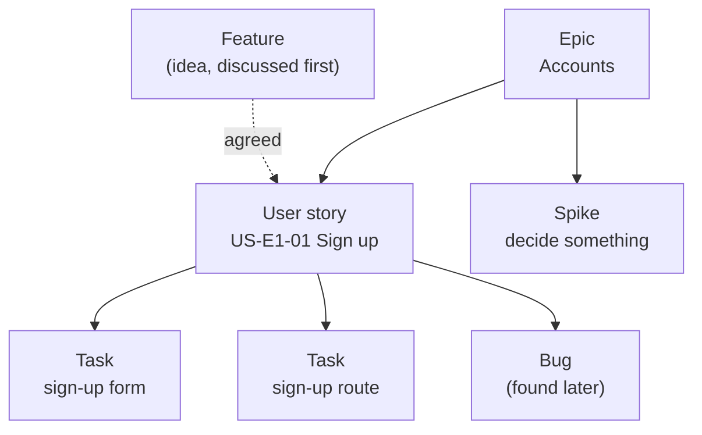

# How to collaborate

This guide explains how we work together: how to pick a task, use git, open a pull request and review someone else's code. If something is unclear, ask in the group chat. Asking early is always better than guessing.

To learn how the code itself works, read the [developer guide](docs/developer-guide.md).

---

## 1. The project board

All work lives on the GitHub project **[Group 5](https://github.com/orgs/MESW-LES-2627/projects/14)**.

**Types of issues** (each has a label and a title prefix):

| Label | Title | What it is |
|---|---|---|
| `epic` | `[Epic] …` | A big feature area (for example *Accounts*). It groups other issues as **sub-issues**. Nobody works on an epic directly. |
| `feature` | `[Feature] …` | An idea or request for new functionality. After the team agrees, it is refined into user stories. |
| `user-story` | `[US] …` | Something a user can do: "As a …, I want …, so that …", with **acceptance criteria**. |
| `task` | `[Task] …` | A technical step: part of a user story, or setup work (CI, configuration). |
| `spike` | `[Spike] …` | Short, time-boxed research to make a decision. The result is knowledge (written down), not code. |
| `bug` | `[Bug] …` | Something that doesn't work as expected. |

How they fit together:



**Fields on the board:**

- **Status:**

  ```mermaid
  flowchart LR
    backlog["Backlog<br/>planned, not ready"] --> ready["Ready<br/>clear, can start"]
    ready --> progress["In progress<br/>someone assigned"]
    progress --> review["In review<br/>PR open"]
    review -- "changes requested" --> progress
    review -- "approved + merged" --> done["Done"]
  ```
- **Priority:** `Urgent`, `High`, `Medium`, `Low`.
- **Iteration:** the two-week period the issue is planned for (Iteration 1 to 4).

When an iteration starts, each user story in it is split into **tasks** (sub-issues of the story), so several people can work on one story.

## 2. Picking up work

1. Open the board, filter by the current iteration, and choose an issue in **Ready** (or Backlog, if agreed with the team).
2. **Assign yourself** and move it to **In progress**, so nobody else starts the same thing.
3. Read the issue, and for a story its **acceptance criteria**. They are what "done" means. If one is unclear, comment on the issue before writing code.
4. **Do only that issue.** Don't implement later steps or someone else's task, even if it looks quick. Small PRs are easier to review and to merge.

## 3. Git workflow, step by step

We never commit directly to `main` or to the iteration branch. Every change goes through a **feature branch** and a **pull request (PR)**.

```text
main  ─────────────────────────────────────────●─────   (end of iteration)  
                                              /
iter0 ──●───────●───────────●────────────────●          (current iteration branch)                                   
         \     /             \              /   
          ●───●  feature/a    ●──●──●──────●  feature/b   
```

PRs go into the **current iteration branch** (today `iter0`), not into `main`. At the end of the iteration, the iteration branch is merged into `main`.

### 3.1 Start a branch

```bash
git switch iter0               # go to the iteration branch
git pull                       # get the latest changes
npm install                    # in case someone added a dependency
git switch -c feature/pad-grid # create your branch
```

Branch names: `feature/<short-name>` in lowercase with dashes (for example `feature/pad-grid`, `feature/server-health-check`). For a bug use `fix/<short-name>`.

### 3.2 Work and commit

```bash
git status                     # what changed?
git diff                       # see the changes line by line
npm run check                  # lint + type check + tests: must pass
git add packages/domain/src/layouts/PadGridLayout.ts packages/domain/src/layouts/PadGridLayout.test.ts
git commit -m "feat(domain): add PadGridLayout with the 2x4 landscape grid"
```

Commit often, each commit one small, complete step.

**Commit messages** follow [Conventional Commits](https://www.conventionalcommits.org/en/v1.0.0/). The format is:

```text
<type>(<scope>): <description>

[optional body: explain why]

[optional footer: Closes #26, BREAKING CHANGE: ...]
```

**Type**, what kind of change it is:

| Type | Use it for | Version bump |
|---|---|---|
| `feat` | A new feature for the user | minor (0.**1**.0 → 0.**2**.0) |
| `fix` | A bug fix | patch (0.1.**0** → 0.1.**1**) |
| `test` | Adding or fixing tests only | — |
| `docs` | Documentation only (README, guides, comments) | — |
| `refactor` | Code change that doesn't change behaviour (rename, move, split a class) | — |
| `style` | Formatting only (spaces, semicolons, indentation) | — |
| `chore` | Maintenance: dependencies, config, scripts | — |
| `ci` | CI/CD workflows (GitHub Actions) | — |
| `build` | Build tools (Vite, TypeScript config) | — |
| `perf` | Makes something faster | patch |

**Scope** (optional) is the part of the project: `domain`, `web`, `server`, `docs`, `ci`, or a smaller area like `audio`, `tracking`, `layouts`.

**Description**:

- English, **imperative**, lowercase first letter: "add", "fix", "move", as if completing "This commit will …".
- Short (the whole first line under ~72 characters), no period at the end.

**Breaking change:** add `!` after the type/scope (`feat(domain)!: rename Layout.hitTest to degreeAt`) and explain it in the footer with `BREAKING CHANGE: ...`. This bumps the major version.

Good:

```text
feat(web): add audio engine
fix(tracking): ignore the non-dominant hand when it is the only one in view
refactor(web): move tracking into packages/web/src
test(domain): cover the volume threshold in Instrument
docs: add the developer guide
chore: add tsx to the server dev dependencies
```

Not good: `changes` · `fixed stuff` · `WIP` · `Feat: Added layout.` (wrong case, past tense, period)

We use this format because the version tags and the `CHANGELOG.md` will be generated from the commit types (#62, #63). Older commits in the history were written before this rule.

### 3.3 Push and keep your branch up to date

```bash
git push -u origin feature/pad-grid   # first push; afterwards just `git push`
```

If `iter0` moved forward while you worked, bring those changes into your branch:

```bash
git switch iter0 && git pull
git switch feature/pad-grid
git merge iter0
```

**If there is a merge conflict:** git marks the conflicting parts in the files like this:

```text
<<<<<<< HEAD
your version
=======
the version from iter0
>>>>>>> iter0
```

Edit the file to keep the right code (often a mix of both), delete the three marker lines, then:

```bash
npm run check
git add <file>
git commit             # finishes the merge
git push
```

If you're unsure, stop and ask someone. Don't delete code you don't understand to make a conflict go away.

## 4. Pull requests

Open the PR on GitHub (it offers a button after you push), with **base: `iter0`** and **compare: your branch**.

**Title:** in the same Conventional Commits format as a commit (`feat(domain): add the 2x4 pad grid layout`). When a PR is squash-merged, the title becomes the commit message on the iteration branch.

**Description:**

```markdown
## What
Short list of what changed.

## Why
The story or task it implements, and any decision you made.

## How to test
1. npm run dev
2. ...
3. npm run check passes

Closes #26
```

`Closes #26` closes the issue automatically when the PR is merged. Move the issue to **In review**.

**Before asking for review, check the [Definition of done](docs/iterations/0/definition-of-done.md):**

- [ ] All acceptance criteria pass.
- [ ] Unit tests for rules; integration tests for server routes; manual test for camera/sound.
- [ ] `npm run check` passes.
- [ ] Docs updated (what the feature does and how to test it).
- [ ] The product owner has tested and approved the story.

Then ask **someone else** in the group to review. You never merge your own PR without an approval.

## 5. Code review

Reviewing is how we learn from each other, not a test. Everyone reviews, including beginners. "I don't understand this part" is a useful review comment.

**What to check:**

1. **Does it do what the issue asks?** Go through the acceptance criteria. Pull the branch and try it (`git fetch && git switch feature/x && npm install && npm run dev`).
2. **Architecture rules** (see the [developer guide](docs/developer-guide.md#5-architecture-rules)): is the code in the right package? Rules in `domain`, browser/library code in adapters?
3. **Tests:** is there a test for each rule? Do the test names say what they check?
4. **Readability:** clear names, small classes and functions, comments that explain *why*.
5. **Scope:** only what the issue asks, nothing else mixed in.

**How to write comments:**

- Be concrete and kind: *"This name is hard to follow. What about `selectedDegree`?"* rather than *"bad name"*.
- Say whether it blocks the merge or is only a suggestion (for example start with "nit:" for small things).
- Use **Approve** when it's ready, **Request changes** when something must be fixed first.

The author answers each comment (a fix, or an explanation), pushes the fixes to the same branch, and asks for review again. After approval, the author merges and moves the issue to **Done**.

## 6. Reporting a bug

Create an issue with the **Bug** template: what happened, steps to reproduce, what you expected, browser, device and severity. Add screenshots or console errors (open DevTools with F12 → *Console*), but **crop out faces**: the camera image shows people.

## 7. Rules to remember

- Code, comments, commits and docs in **English**.
- Run `npm run check` before every commit.
- **Don't add libraries, folders or packages** without asking the team first.
- Don't edit `CLAIM.md` or `retro.md` unless asked.
- Keep code simple: small classes, clear names, comments that explain *why*.
- When you use AI tools, write it down in the iteration's `ai-log.md` (for example [docs/iterations/0/ai-log.md](docs/iterations/0/ai-log.md)).
