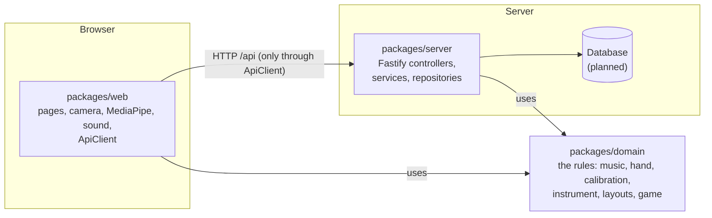
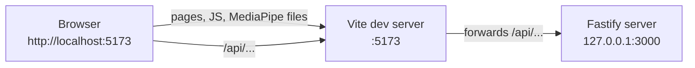

# Gesture-Based Web Instrument

A musical instrument that runs in the browser and is played with your hand instead of a keyboard. The webcam image is analysed in real time with MediaPipe: **where your index finger points chooses the note**, and **how open your hand is sets the volume**. A small game, *Listen and Repeat*, helps beginners learn short melodies. An account is optional and only saves your settings and progress.

**LES - TEAM E** · FEUP - 2026/27

- Daniel Tavares da Silva Marques - up202306365@up.pt
- Luís Pedro Ferreira Rodrigues - up201303586@up.pt
- Artur Rodrigues Sousa Alves - up202602746@up.pt
- Gabriel Henrique Dias Conte - up202500543@up.pt
- Mahsa Karimi - up202602749@up.pt

**Guides:** [How to collaborate](CONTRIBUTING.md) · [How the code works](docs/developer-guide.md) 

**Try it online:** https://cerulean-belekoy-04c928.netlify.app (test deploy of the web app only, so it shows "Server: offline". Use Chrome or Edge with a webcam and play with your right hand.)

---

## Tech stack

| Technology | What we use it for |
|---|---|
| [TypeScript](https://www.typescriptlang.org/) | The only language in the project: JavaScript with types, so many mistakes are caught before running the code. |
| [npm workspaces](https://docs.npmjs.com/cli/using-npm/workspaces) | One repository with several packages (`domain`, `web`, `server`) that share one `npm install`. |
| [Vite](https://vite.dev/) | Runs the web app in development (with instant reload) and builds it for production. |
| [MediaPipe Hand Landmarker](https://ai.google.dev/edge/mediapipe/solutions/vision/hand_landmarker) (`@mediapipe/tasks-vision`) | Finds the hand in each camera frame and returns 21 points (wrist, finger joints, fingertips). |
| [Web Audio API](https://developer.mozilla.org/en-US/docs/Web/API/Web_Audio_API) | Built into the browser. Generates the sound of the note. |
| [Fastify](https://fastify.dev/) | The web server framework. Only used in the server's HTTP layer (controllers). |
| [Vitest](https://vitest.dev/) | Runs the automated tests. |
| [ESLint](https://eslint.org/) + [typescript-eslint](https://typescript-eslint.io/) | Finds code problems and **enforces our architecture rules** (for example, "the domain can't use the browser"). |

No UI framework (no React): pages are plain TypeScript classes that create and update HTML elements.

## Architecture at a glance



- **`domain`** holds the rules (which note is under the finger, when a note starts, how a scale works). It uses no libraries and no browser APIs, so it is easy to test.
- **`web`** is the browser app. It connects the rules to the real world: camera, MediaPipe, speakers and the screen.
- **`server`** is only needed for the optional accounts. The instrument and the game work without it.
- Everything that must be fast (tracking, sound, game) runs **in the browser**.

The full explanation, with the real-time pipeline step by step, is in the [developer guide](docs/developer-guide.md).

## Project structure

```text
.
├── packages/
│   ├── domain/            # Rules only. No libraries, no browser APIs.
│   │   └── src/
│   │       ├── music/         # Degree, PitchClass, ScaleType, Scale (degree → note → frequency)
│   │       ├── hand/          # TrackedHand, HandFeatureExtractor (pointer + openness), pickHand
│   │       ├── calibration/   # ControlCalibration, CalibrationProfile (raw values → 0..1)
│   │       ├── layouts/       # Layout interface, Region, SingleBoxLayout
│   │       ├── instrument/    # Instrument (when notes start/stop), InstrumentFrame
│   │       ├── geometry/      # Point
│   │       ├── index.ts       # Everything other packages may import
│   │       └── testing.ts     # Test helpers (makeHand)
│   ├── web/               # The browser app (Vite)
│   │   ├── index.html
│   │   ├── vite.config.ts     # Dev server on :5173, forwards /api to the server
│   │   └── src/
│   │       ├── main.ts        # Composition root: creates and connects all objects
│   │       ├── camera/        # Camera (opens the webcam)
│   │       ├── tracking/      # HandTracker interface, MediaPipeHandTracker, FakeHandTracker
│   │       ├── audio/         # Synth interface, WebAudioSynth, SoundOutput
│   │       ├── instrument/    # InstrumentLoop (runs the pipeline on every camera frame)
│   │       ├── pages/         # InstrumentPage (draws the screen)
│   │       └── api/           # ApiClient (the only code that talks to the server)
│   └── server/            # Fastify server on :3000
│       └── src/
│           ├── main.ts        # Starts the server
│           ├── app.ts         # buildApp(): creates the app with all routes (used by tests too)
│           └── controllers/   # HTTP routes (HealthController)
├── scripts/
│   ├── dev.mjs                # `npm run dev`: starts server and web together
│   └── copy-mediapipe-wasm.mjs # Runs after `npm install`
├── docs/                  # Vision, MVP, user stories, design models, iteration notes
├── eslint.config.js       # Lint + architecture rules
├── tsconfig.base.json     # Shared TypeScript settings
└── vitest.config.ts       # Test settings
```

## Requirements

- **Node.js 24** or newer. Check with `node -v`. If you use [nvm](https://github.com/nvm-sh/nvm), run `nvm use`: it reads the version from `.nvmrc`.
- **Chrome or Edge** on a computer (Android Chrome and iPhone Safari are supported too, but test on desktop first).
- A **webcam**.

## How to run

```bash
git clone https://github.com/MESW-LES-2627/les-project-group-5.git
cd les-project-group-5
npm install      # installs everything for all packages
npm run dev      # starts the server and the web app
```

- `npm install` also runs `scripts/copy-mediapipe-wasm.mjs`, which copies MediaPipe's files into `packages/web/public/mediapipe/` so the browser can load them. That folder is not in git: it is recreated on every install.
- `npm run dev` starts **two programs**: the server at http://127.0.0.1:3000 and the web app at **http://localhost:5173**. Each line in the terminal starts with `[server]` or `[web]` so you know who wrote it. Press **Ctrl+C** once to stop both.



The browser only talks to Vite. Vite forwards every `/api` request to the server, so both look like one address.

Open http://localhost:5173. You should see:

1. "Server: online" at the top (it turns to "offline" within 10 seconds if the server stops; the instrument keeps working).
2. A **Start** button. Press it and allow the camera.
3. Your camera image with a box in the middle. Point your **right index finger** at the box and **open your hand**: a note (C) plays, louder as you open the hand. Close the hand or leave the box and it stops.

You can also run one part only: `npm run dev -w @instrument/web` or `npm run dev -w @instrument/server`.

## How to test

| Command | What it does |
|---|---|
| `npm run check` | **Run this before every commit.** Lint + type check + all tests. Same as running the three commands below. |
| `npm run lint` | ESLint: code problems and architecture rules. |
| `npm run typecheck` | TypeScript compiler for `domain`, `web` and `server`, without building. |
| `npm test` | All tests once (`*.test.ts` files in `packages/*/src`). |
| `npm run test:watch` | Tests again on every save. Handy while you work. |
| `npm run build` | Production build of the web app into `packages/web/dist/`. |

Run one test file, or only the tests whose name matches some text:

```bash
npx vitest run packages/domain/src/music/Scale.test.ts
npx vitest run -t "starts a note"
```

**What the tests cover:** rules in `domain` (unit tests), the instrument loop and sound output with fakes (no camera or speakers), `ApiClient` with a fake `fetch`, and server routes with `app.inject` (no network). See [Testing](docs/developer-guide.md#7-testing) in the developer guide.

**Manual test (camera and sound can't be tested automatically).** For every change that touches them, check in Chrome:

- [ ] Start asks for the camera, and the image appears mirrored (moving right moves the pointer right).
- [ ] The pointer follows the index fingertip, and only the right hand plays.
- [ ] Open hand over a cell: the note plays. Closed hand or outside the cell: silence. No clicks.
- [ ] The volume bar follows how open the hand is.
- [ ] Blocking the camera shows a clear message and a "Try again" button.

## Troubleshooting

| Problem | What to do |
|---|---|
| "Camera access is blocked" | Click the camera icon in the address bar, allow it, then press Try again. |
| "No camera found" / camera won't start | Plug in a camera, close other apps that use it (Zoom, Teams, …), press Try again. |
| "This page can't use the camera" | Open the app from `http://localhost:5173`, not from an IP address. Browsers only allow the camera on `localhost` or `https://`. |
| "Hand tracking could not be loaded" | Run `npm install` again (it re-copies the MediaPipe files), then reload the page. |
| "Server: offline" | Check the `[server]` lines in the terminal for an error. The instrument works anyway. |
| `EADDRINUSE` (port in use) | Another `npm run dev` is still running. Close it, or find it with `lsof -i :5173` / `lsof -i :3000`. |
| Strange errors after `git pull` | Run `npm install` (someone may have added a dependency). |
| `npm install` fails / syntax errors | Check `node -v` is 24 or newer. |
