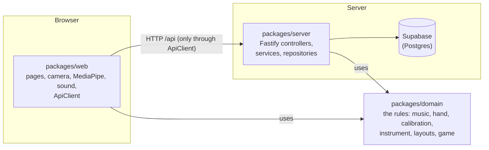
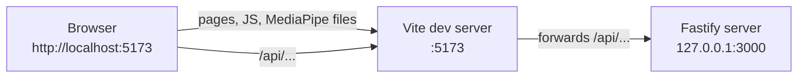
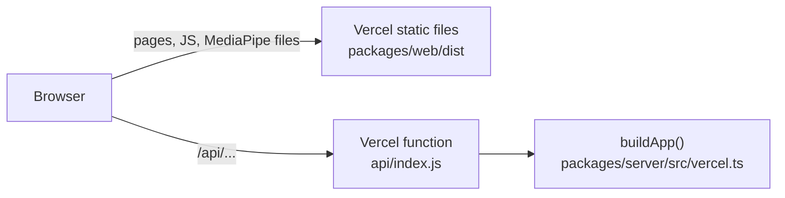

# Gesture-Based Web Instrument

A musical instrument that runs in the browser and is played with your hand instead of a keyboard. The webcam image is analysed in real time with MediaPipe: **where your index finger points chooses the note**, and **how open your hand is sets the volume**. A small game, *Listen and Repeat*, helps beginners learn short melodies. An account is optional and only saves your settings and progress.

**LES - TEAM E** · FEUP - 2026/27

- Daniel Tavares da Silva Marques - up202306365@up.pt
- Luís Pedro Ferreira Rodrigues - up201303586@up.pt
- Artur Rodrigues Sousa Alves - up202602746@up.pt
- Gabriel Henrique Dias Conte - up202500543@up.pt
- Mahsa Karimi - up202602749@up.pt

**Guides:** [How to collaborate](CONTRIBUTING.md) · [How the code works](docs/developer-guide.md) · [Design report](docs/design.md)


---

## Tech stack

| Technology | What we use it for |
|---|---|
| [TypeScript](https://www.typescriptlang.org/) | The only language in the project: JavaScript with types, so many mistakes are caught before running the code. |
| [npm workspaces](https://docs.npmjs.com/cli/using-npm/workspaces) | One repository with several packages (`domain`, `web`, `server`) that share one `npm install`. |
| [Vite](https://vite.dev/) | Runs the web app in development (with instant reload) and builds it for production. |
| [MediaPipe Hand Landmarker](https://ai.google.dev/edge/mediapipe/solutions/vision/hand_landmarker) (`@mediapipe/tasks-vision`) | Finds the hand in each camera frame and returns 21 points (wrist, finger joints, fingertips). |
| [Web Audio API](https://developer.mozilla.org/en-US/docs/Web/API/Web_Audio_API) | Built into the browser. Generates the sound of the note. |
| [Fastify](https://fastify.dev/) | The web server framework. Only used in the server's HTTP layer (controllers). |
| [PostgreSQL](https://www.postgresql.org/) on [Supabase](https://supabase.com/) + [`pg`](https://node-postgres.com/) | Hosted database for the optional accounts and saved data. Only the server talks to it, with hand-written SQL through `pg` (no `supabase-js`, no Supabase Auth). |
| [Vitest](https://vitest.dev/) | Runs the automated tests. |
| [ESLint](https://eslint.org/) + [typescript-eslint](https://typescript-eslint.io/) | Finds code problems and **enforces our architecture rules** (for example, "the domain can't use the browser"). |
| [Semgrep](https://semgrep.dev/) | Security scan in CI: finds risky code such as SQL built from strings or server data put in `innerHTML`. |

No UI framework (no React): pages are plain TypeScript classes that create and update HTML elements.

## Architecture at a glance



- **`domain`** holds the rules (which note is under the finger, when a note starts, how a scale works). It uses no libraries and no browser APIs, so it is easy to test.
- **`web`** is the browser app. It connects the rules to the real world: camera, MediaPipe, speakers and the screen.
- **`server`** is only needed for the optional accounts. The instrument and the game work without it.
- Everything that must be fast (tracking, sound, game) runs **in the browser**.

The full explanation, with the real-time pipeline step by step, is in the [developer guide](docs/developer-guide.md).

## Project structure

```text
.
├── packages/
│   ├── domain/            # Rules only. No libraries, no browser APIs.
│   │   └── src/
│   │       ├── music/         # Degree, PitchClass, ScaleType, Scale (degree → note → frequency)
│   │       ├── hand/          # TrackedHand, HandFeatureExtractor (pointer + openness), pickHand
│   │       ├── calibration/   # ControlCalibration, CalibrationProfile (raw values → 0..1)
│   │       ├── layouts/       # Layout interface, Region, SingleBoxLayout
│   │       ├── instrument/    # Instrument (when notes start/stop), InstrumentFrame
│   │       ├── geometry/      # Point
│   │       ├── index.ts       # Everything other packages may import
│   │       └── testing.ts     # Test helpers (makeHand)
│   ├── web/               # The browser app (Vite)
│   │   ├── index.html
│   │   ├── vite.config.ts     # Dev server on :5173, forwards /api to the server
│   │   └── src/
│   │       ├── main.ts        # Composition root: creates and connects all objects
│   │       ├── camera/        # Camera (opens the webcam)
│   │       ├── tracking/      # HandTracker interface, MediaPipeHandTracker, FakeHandTracker
│   │       ├── audio/         # Synth interface, WebAudioSynth, SoundOutput
│   │       ├── instrument/    # InstrumentLoop (runs the pipeline on every camera frame)
│   │       ├── pages/         # InstrumentPage (draws the screen)
│   │       └── api/           # ApiClient (the only code that talks to the server)
│   └── server/            # Fastify server on :3000
│       ├── .env               # DATABASE_URL, EMAIL_USER, EMAIL_PASS (not in git, see "How to run")
│       └── src/           # One folder per feature (see developer guide, "The server")
│           ├── main.ts        # Composition root: reads config, creates the database pool, starts the server
│           ├── app.ts         # buildApp(): creates the app with all routes (used by tests too)
│           ├── config/        # env.ts: reads and checks .env values
│           ├── shared/        # Code used by several features (database/createDatabasePool, email/ senders)
│           └── features/
│               └── health/    # HealthController, DatabaseStatus, PostgresDatabaseStatus
├── scripts/
│   ├── dev.mjs                # `npm run dev`: starts server and web together
│   ├── copy-mediapipe-wasm.mjs # Runs after `npm install`
│   └── migrate.sh             # Runs the migrations on the local Docker database (see "Run with Docker")
├── docs/                  # Vision, MVP, user stories, design models, iteration notes
├── compose.yaml           # `docker compose up`: web, server and a local PostgreSQL (see "Run with Docker")
├── Dockerfile             # The development image used by compose.yaml
├── eslint.config.js       # Lint + architecture rules
├── .semgrep/              # Our Semgrep security rules (rules.yml) and their test examples (rules.ts)
├── .semgrepignore         # Files the Semgrep scan skips
├── tsconfig.base.json     # Shared TypeScript settings
└── vitest.config.ts       # Test settings
```

## Requirements

- **Node.js 24** or newer. Check with `node -v`. If you use [nvm](https://github.com/nvm-sh/nvm), run `nvm use`: it reads the version from `.nvmrc`.
- **Chrome or Edge** on a computer (Android Chrome and iPhone Safari are supported too, but test on desktop first).
- A **webcam**.
- Access to the team's **Supabase** project (for the database connection string), **or** [Docker Desktop](https://www.docker.com/products/docker-desktop/) to run everything with a local database (see [Run with Docker](#run-with-docker)).

## How to run

```bash
git clone https://github.com/MESW-LES-2627/les-project-group-5.git
cd les-project-group-5
npm install      # installs everything for all packages
cp packages/server/.env.example packages/server/.env
npm run dev      # starts the server and the web app
```

Before the first `npm run dev`, create `packages/server/.env` with the database connection string:

```bash
DATABASE_URL=postgresql://postgres.<project-ref>:<password>@aws-0-<region>.pooler.supabase.com:6543/postgres
```

To send real emails (account confirmation, password reset), also add the email account that sends them (Gmail by default):

```bash
EMAIL_USER=you@gmail.com
EMAIL_PASS=your-app-password
# Optional: EMAIL_FROM="Instrument <you@gmail.com>", and SMTP_HOST / SMTP_PORT for a provider other than Gmail
```

Both are optional locally: without them, emails are only written to the `[server]` log, so you can open the links from there. For Gmail, `EMAIL_PASS` must be an [App Password](https://myaccount.google.com/apppasswords) (needs 2-Step Verification), not the account's normal password.

This file is in `.gitignore`: **never commit it**, because it contains the database password and the email password. Never put them in the web app. On Vercel, set `DATABASE_URL`, `EMAIL_USER` and `EMAIL_PASS` in the project's environment variables instead. The server stops at start-up with a clear message if a value is missing. Node loads the file itself (`--env-file-if-exists` in `packages/server/package.json`), so no extra library is needed.

- `npm install` also runs `scripts/copy-mediapipe-wasm.mjs`, which copies MediaPipe's files into `packages/web/public/mediapipe/` so the browser can load them. That folder is not in git: it is recreated on every install.
- `npm run dev` starts **two programs**: the server at http://127.0.0.1:3000 and the web app at **http://localhost:5173**. Each line in the terminal starts with `[server]` or `[web]` so you know who wrote it. Press **Ctrl+C** once to stop both.



The browser only talks to Vite. Vite forwards every `/api` request to the server, so both look like one address.

Open http://localhost:5173. You should see:

1. "Server: online" and "Database: online" in the bottom bar (they turn to "offline" within 10 seconds if the server or the database stops; the instrument keeps working).
   You can also open http://localhost:5173/api/health: it answers `{"status":"ok","database":"online"}`. `database` is `offline` if the database can't be reached; the server still runs.
2. A **Start** button. Press it and allow the camera.
3. Your camera image with a box in the middle. Point your **right index finger** at the box and **open your hand**: a note (C) plays, louder as you open the hand. Close the hand or leave the box and it stops.

You can also run one part only: `npm run dev -w @instrument/web` or `npm run dev -w @instrument/server`.

## Run with Docker

Docker runs the web app, the server **and a local PostgreSQL** with one command, so everyone has the same environment. You don't need Node.js or the Supabase connection string, only [Docker Desktop](https://www.docker.com/products/docker-desktop/) (open it before running the commands).

```bash
git clone https://github.com/MESW-LES-2627/les-project-group-5.git
cd les-project-group-5
docker compose up --build -V   # first time, or after a dependency changes
docker compose up           # the next times
```

Open **http://localhost:5173**, as with `npm run dev`. Press **Ctrl+C** to stop.

| Service | What it is | From your computer |
|---|---|---|
| `instrument-web` | Vite dev server | http://localhost:5173 |
| `instrument-server` | Fastify server | Only through the web app (`/api/...`) |
| `instrument-db` | PostgreSQL 17 | `localhost:5433`, user `postgres`, password `postgres`, database `instrument` |
| `instrument-migrate` | Runs the migrations, then stops | — |

- **Your code is mounted into the containers**, so saving a file reloads the app, as without Docker. Rebuild (`--build -V`) only when `package.json` or `package-lock.json` changes. `-V` matters: without it, the containers keep the old dependencies from the previous run instead of the new ones in the image.
- **The data is kept in a Docker volume** (`db-data`): it survives `docker compose down` and restarts.
- **Migrations run on every `docker compose up`**, before the server starts: every file in `packages/server/migrations/` that hasn't run yet, in number order. So after you pull a new migration, `docker compose up` applies it. Which ones ran is kept in the `schema_migrations` table, so a migration never runs twice. If one fails, the server doesn't start: see the error with `docker compose logs instrument-migrate`.
- **Run migrations yourself** (with or without the app running):

  | Command | What it does |
  |---|---|
  | `docker compose run --rm instrument-migrate` | Runs all migrations that haven't run yet. |
  | `docker compose run --rm instrument-migrate 003` | Runs only migration 003 (the number, or the full file name `003_create_something.sql`). |

  A migration that already ran is refused. To start again with an empty database (this **deletes all local data**): `docker compose down -v`, then `docker compose up`.
- These commands are only for the local database. The Supabase databases are still migrated by hand (see [ADR 001](docs/adr/001-database-choice.md)).
- The server uses the local database, never Supabase: `compose.yaml` sets `DATABASE_URL` and `DATABASE_SSL=false`, which win over `packages/server/.env`.
- Port already in use? Stop whatever uses it (often `npm run dev` in another terminal) or change the left number in `ports:` in `compose.yaml`.

## How to test

| Command             | What it does                                                                                              |
|---------------------|-----------------------------------------------------------------------------------------------------------|
| `npm run check`     | **Run this before every commit.** Lint + type check + all tests. Same as running the three commands below. |
| `npm run lint`      | ESLint: code problems and architecture rules.                                                             |
| `npm run lint:fix`  | ESLint: fix code problems.                                                          |
| `npm run typecheck` | TypeScript compiler for `domain`, `web` and `server`, without building.                                   |
| `npm test`          | All tests once (`*.test.ts` files in `packages/*/src`).                                                   |
| `npm run test:watch` | Tests again on every save. Handy while you work.                                                          |
| `npm run build`     | Production build of the web app into `packages/web/dist/`.                                                |

Run one test file, or only the tests whose name matches some text:

```bash
npx vitest run packages/domain/src/music/Scale.test.ts
npx vitest run -t "starts a note"
```

**What the tests cover:** rules in `domain` (unit tests), the instrument loop and sound output with fakes (no camera or speakers), `ApiClient` with a fake `fetch`, and server routes with `app.inject` and a fake `DatabaseStatus` (no network, no real database). See [Testing](docs/developer-guide.md#7-testing) in the developer guide.

**Manual test (camera and sound can't be tested automatically).** For every change that touches them, check in Chrome:

- [ ] Start asks for the camera, and the image appears mirrored (moving right moves the pointer right).
- [ ] The pointer follows the index fingertip, and only the right hand plays.
- [ ] Open hand over a cell: the note plays. Closed hand or outside the cell: silence. No clicks.
- [ ] The volume bar follows how open the hand is.
- [ ] Blocking the camera shows a clear message and a "Try again" button.

## Security scan (Semgrep)

Every pull request and every push to `staging` or `main` runs [Semgrep](https://semgrep.dev/) in CI (the `semgrep` job in `.github/workflows/ci.yml`). It checks the code with:

- **Public rule packs** for this stack: `p/javascript`, `p/typescript`, `p/nodejs`, `p/secrets`, `p/github-actions` and `p/dockerfile`.
- **Our own rules** in `.semgrep/rules.yml`: SQL built with `${}` or `+` instead of `$1` placeholders, `Math.random()` on the server, secrets compared with `===`, a database URL with a password in the code, passwords or tokens in logs, cookies without `httpOnly`, redirects to a URL taken from the request, and user or server data put in `innerHTML`.

**Any finding fails the job, and `deploy` only runs when it passes.**

On a pull request the job also writes **one comment with the scan summary** (✅ no findings, or a table with each finding, its rule and a link to the line). New pushes update that same comment instead of adding more. The same summary is on the run's **Summary** page in the Actions tab. The summary is built by `scripts/semgrep-summary.mjs` from Semgrep's JSON output.

Semgrep isn't an npm package, so install it once (Python 3.9+ or Homebrew):

```bash
brew install semgrep        # macOS
pipx install semgrep        # or: python3 -m pip install semgrep
```

Then, from the repository root, run the same commands as CI:

```bash
# Check that our rules still catch the bad examples in .semgrep/rules.ts
semgrep --test --config .semgrep/rules.yml .semgrep/rules.ts --metrics=off

# Full scan (same rule packs as CI; exit code 1 if anything is found)
semgrep scan \
  --config p/javascript --config p/typescript --config p/nodejs \
  --config p/secrets --config p/github-actions --config p/dockerfile \
  --config .semgrep/rules.yml \
  --metrics=off --error

# Quick scan with only our rules (no internet needed)
semgrep scan --config .semgrep/rules.yml --metrics=off
```

Without installing anything, with Docker:

```bash
docker run --rm -v "$PWD:/src" -w /src semgrep/semgrep:1.187.0 \
  semgrep scan --config .semgrep/rules.yml --metrics=off --error
```

**When Semgrep finds something:**

- **Real problem:** fix the code. The message explains the safe way (for example, use `textContent` instead of `innerHTML`).
- **False positive:** add `// nosemgrep: <rule-id>` on the line above it, with a comment saying why it is safe. For an example, see the TLS option in `packages/server/src/shared/database/createDatabasePool.ts`.
- **New rule:** add it to `.semgrep/rules.yml`, plus a `// ruleid: <id>` example (must be flagged) and an `// ok: <id>` example (must not be flagged) in `.semgrep/rules.ts`, then run `semgrep --test` as above. ESLint and TypeScript skip `.semgrep/` because those examples are insecure on purpose.

## Deploy

The web app and the API deploy together to [Vercel](https://vercel.com/), as one project on one address, from the GitHub Action in `.github/workflows/ci.yml`:

| Event | What runs |
|---|---|
| Pull request | Lint, type check and all tests. Nothing is deployed. |
| Push to `staging` | The same checks, then a deploy to the Vercel **preview** environment. |
| Push to `main` | The same checks, then a deploy to Vercel **production**. |

If a check fails, nothing is deployed. The deploy link is in the summary of the "CI" run.

How the two parts are served (settings in `vercel.json`):



- `npm run build:api` bundles the server (entry point `packages/server/src/vercel.ts`) into `api/index.js`. That file is generated, so it is not in git.
- On Vercel the server does not listen on a port. Vercel calls it once per `/api` request, and it may be stopped between requests.

To try the production build on your machine: `npm run build:api && vercel build && vercel deploy --prebuilt` (needs `vercel login` and `vercel link` once).

## Troubleshooting

| Problem | What to do |
|---|---|
| "Camera access is blocked" | Click the camera icon in the address bar, allow it, then press Try again. |
| "No camera found" / camera won't start | Plug in a camera, close other apps that use it (Zoom, Teams, …), press Try again. |
| "This page can't use the camera" | Open the app from `http://localhost:5173`, not from an IP address. Browsers only allow the camera on `localhost` or `https://`. |
| "Hand tracking could not be loaded" | Run `npm install` again (it re-copies the MediaPipe files), then reload the page. |
| "Server: offline" | Check the `[server]` lines in the terminal for an error. The instrument works anyway. |
| "Database: offline" (server online) | The server can't reach the database: see the `"database":"offline"` row below. |
| `Missing DATABASE_URL` | Create `packages/server/.env` with the connection string (see "How to run"). |
| `/api/health` says `"database":"offline"` | Check `DATABASE_URL` in `packages/server/.env` (password replaced, transaction pooler on port 6543), your internet connection, and that the Supabase project is not paused. The `[server]` log shows the connection error. |
| No email arrives | Without `EMAIL_USER` and `EMAIL_PASS` the email is only in the `[server]` log. With them, check the `[server]` log for the SMTP error (for Gmail, `Invalid login` means the App Password is wrong or missing). Also check the spam folder. |
| `EADDRINUSE` (port in use) | Another `npm run dev` is still running. Close it, or find it with `lsof -i :5173` / `lsof -i :3000`. |
| Strange errors after `git pull` | Run `npm install` (someone may have added a dependency). |
| `npm install` fails / syntax errors | Check `node -v` is 24 or newer. |
