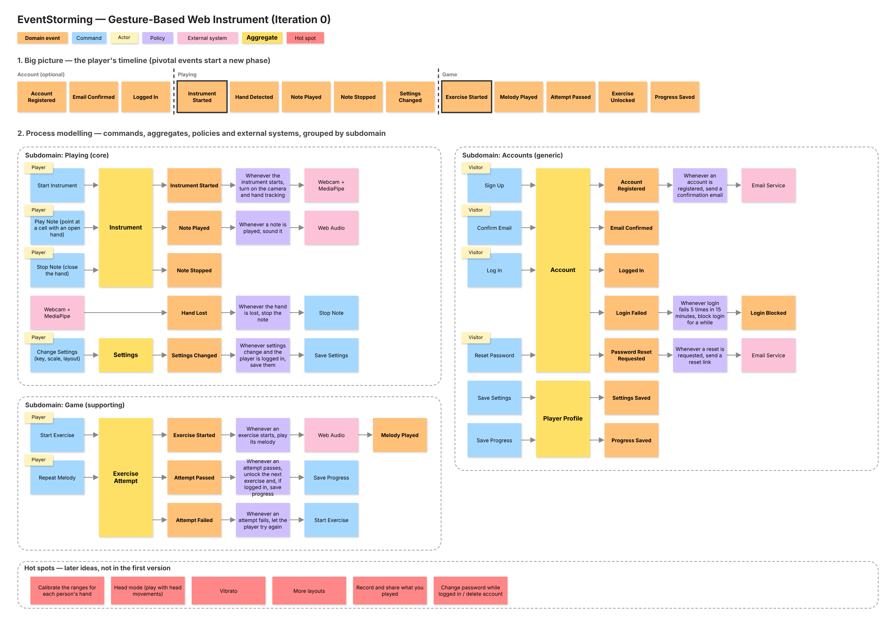
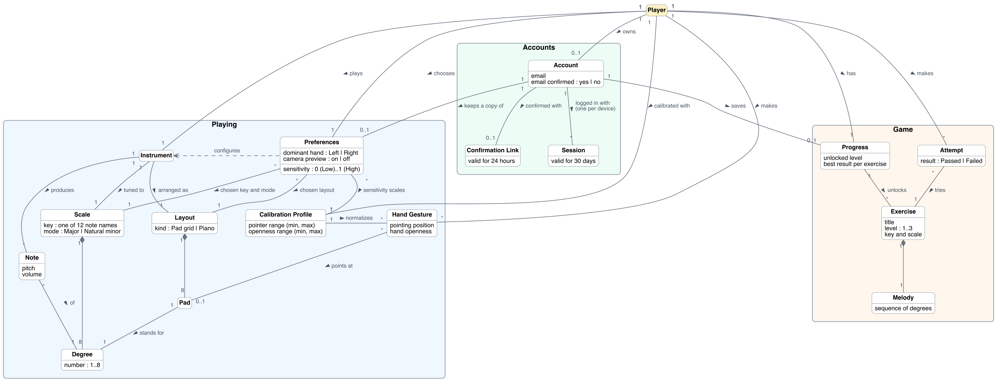
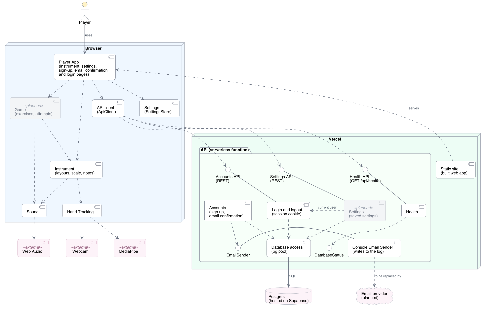

# Design Report — Gesture-Based Web Instrument

This report describes the design of the project and the reasons behind it. It is updated at the end of every iteration. The sources of the models are in [`design/`](design/): the EventStorming board opens in [diagrams.net](https://app.diagrams.net) and the UML diagrams are [PlantUML](https://plantuml.com) files.

## History

| Iteration | Changes |
|---|---|
| 0 | First version of the EventStorming board, the domain model and the component diagram. |
| 1 | Domain model: Preferences moved to Playing, Calibration Profile added. Components: Vercel, Postgres on Supabase, Health, Settings. Change scenario 1. |
| 2 | Report reorganized, project overview and EventStorming findings added. Domain model: accounts as built, key, scale and layout as preferences. Components: Accounts (sign up), Email Sender and API client. Scenario 1 analysis rewritten. Change scenario 2. |

## 1. Project overview

A musical instrument that runs in the browser and is played with hand gestures in front of a webcam: the hand's position chooses the note and its openness sets the volume. It is meant for beginners, for music students without an instrument, and for people with a limited range of motion. See the [vision](iterations/0/vision.md) and the [MVP](iterations/0/mvp.md).

**Central responsibilities:** turn the camera image into sound in real time; let the player adjust the instrument; an ear-training game (planned); optional accounts that keep settings and progress.

**Constraints that shape the design:**

- **Real time runs in the browser.** The camera image never leaves the device, and the network would be too slow for playing.
- **The account is optional.** Every page works without logging in, so the instrument cannot depend on the server.
- **Vercel:** static site plus a serverless API, with no state kept in memory between requests.
- **Postgres on Supabase, used only as a database** ([ADR 001](adr/001-database-choice.md)).
- **Few frameworks:** plain TypeScript, Fastify only for HTTP, hand-written SQL, dependencies created by hand.
- **External systems:** webcam, MediaPipe, Web Audio and an email provider (not chosen yet).

## 2. Domain discovery and modeling

### 2.1. EventStorming results

The board ([source](design/eventstorming.drawio)) shows the player's timeline (account, playing, game) and, for each subdomain, the commands, aggregates, events, policies and external systems.

**Main findings:**

- **Three subdomains.** Playing is **core** (it is what makes the product different), Game is **supporting**, and Accounts is **generic**. They became the main boundaries of the code.
- **Playing is a fast loop.** *Hand Detected → Note Played → Note Stopped* repeats many times per second, and *Hand Lost* must stop the note. So the loop runs in the browser, with the rules kept apart from the camera and audio.
- **Saving is an extra step.** The policies say "*if logged in*, save the settings / progress", so playing works the same without an account. That is why Preferences belong to Playing, not to Accounts ([scenario 2](#42-scenario-2--saving-the-settings-in-the-account-iteration-2)).
- **Account rules:** confirmation email, login blocked after 5 failures in 15 minutes, password reset by email.
- **Hot spots** (open questions): per-user calibration ([scenario 1](#41-scenario-1--per-user-hand-calibration-iteration-1)), head mode, vibrato, more layouts, recording.

### 2.2. Domain model

The model ([source](design/domain-model.puml)) uses the words of the problem, not of the code.

- **Playing.** The player's **calibration profile** turns a hand gesture into values from 0 to 1. The gesture points at a **pad** of the **layout**, and the hand's openness sets the volume. Each pad stands for a **degree** of the **scale** (a key and a mode, major or natural minor).
- **Preferences:** dominant hand, camera preview, key, mode and layout (pad grid or single box); sensitivity is planned. An account only keeps a copy of them.
- **Game.** An exercise has a melody (a sequence of degrees). Passing an attempt unlocks the next exercise.
- **Accounts.** An account can be used only after its email is confirmed with a **confirmation link** (valid for 24 hours). Each logged-in device has a **session** (valid for 30 days).

**Non-obvious choices:**

- The calibration profile belongs to the player, because it describes the body and the camera, not the music.
- A pad stands for a *degree*, not a pitch, so changing the key doesn't change the layout.

## 3. High-level architecture

[Source](design/component-diagram.puml). Components marked **«planned»** are not built yet.

| Component | Responsibility |
|---|---|
| **Player App** | The pages and the composition root [`main.ts`](../packages/web/src/main.ts), the only place that creates and connects the concrete classes. |
| **Settings** | [`SettingsStore`](../packages/web/src/settings/SettingsStore.ts) holds the player's choices and notifies when one changes. |
| **Instrument** | The rules of playing (layouts, scale, notes), in the `domain` package, with no dependency on the browser. |
| **Hand Tracking, Sound** | Wrap MediaPipe and Web Audio behind interfaces ([`HandTracker`](../packages/web/src/tracking/HandTracker.ts), [`Synth`](../packages/web/src/audio/Synth.ts)). |
| **API client** | [`ApiClient`](../packages/web/src/api/ApiClient.ts), the only code that calls the server. |
| **Game** «planned» | Exercises and attempts. |
| **API** | A serverless function built with Fastify. Each feature has a controller, a service and a repository interface, connected in [`createDependencies.ts`](../packages/server/src/createDependencies.ts). |
| **Health** | `GET /api/health`, which checks the server and the database. |
| **Accounts** | Sign up is built; email confirmation and login are «planned» (in review). |
| **Email Sender** | The `EmailSender` interface; for now the emails go to the log. The real provider is «planned». |
| **Database access** | One `pg` pool and hand-written SQL to Postgres on Supabase. |

**Why these boundaries:**

- **Real time in the browser, accounts on the server**, connected only through the API client, so the instrument works when the server is down.
- **Domain rules apart from browser APIs.** Playing is the part that changes most, and this boundary lets it change and be tested without a camera or speakers.
- **Interfaces at the server's edges** (repositories, `EmailSender`), so services are tested with fakes and the email provider can be chosen later.

## 4. Future change scenarios: coupling, cohesion, and design decisions

We analyze coupling in three dimensions:

- **Strength:** how much one part knows about another. From strongest to weakest: *intrusive*, *functional* (shared rule), *model* (shared data model), *contract* (only an agreed interface).
- **Distance:** same module, another package, another program over the network, or data stored today and read by future code.
- **Volatility:** how often the parts change (the core subdomain changes most).

Strong coupling is fine at short distance, and long distance is fine with weak coupling. The risk is **strong + distant + volatile**.

### 4.1. Scenario 1 — Per-user hand calibration (Iteration 1)

*Written on 2026-11-04. Analysis rewritten on 2026-11-15 with the three dimensions; the decision did not change.*

#### Change scenario and design context

Everyone plays with the same [`DEFAULT_CALIBRATION_PROFILE`](../packages/domain/src/calibration/CalibrationProfile.ts), so some players can't reach the edge pads or full volume, especially players with a limited range of motion. In the change, a calibration assistant measures the player's ranges and the instrument uses **that player's profile**.

Affected: [`InstrumentLoop`](../packages/web/src/instrument/InstrumentLoop.ts) (keeps the profile `readonly`), [`main.ts`](../packages/web/src/main.ts), [`SettingsStore`](../packages/web/src/settings/SettingsStore.ts), a new calibration page, and saving the profile in the account. `CalibrationProfile` itself doesn't change: a measured profile is just another instance.

#### Coupling and cohesion analysis

| Coupling | Strength | Distance | Volatility | Result |
|---|---|---|---|---|
| `InstrumentLoop` → `CalibrationProfile` | Model (domain type, injected) | Short | High (core) | Balanced: the loop doesn't know where the profile comes from |
| `main.ts` → default profile | Model | Short | Low | Fine: the composition root knows every part |
| Profile → saved in the account | Model | Long | High | Risky; handled in scenario 2 |

- **What breaks:** only the `readonly` profile in the loop, which needs a setter.
- **Cohesion:** the `calibration` module only normalizes values; which profile to use is decided in `main.ts`. `SettingsStore` repeats the same getter, setter and listeners for each setting (two settings on 11-04, five on 11-15).

#### Alternatives, decision, and consequences

- **(a) The loop reads the profile from `SettingsStore`.** Fewer lines, but the loop would depend on a class that changes with every new setting.
- **(b) Inject the profile from `main.ts`,** with `SettingsStore` as the only source and `loop.setCalibrationProfile()`, as already done for the dominant hand.
- **(c) A `CalibrationSource` interface asked every frame.** Weaker coupling, but the distance is already short, so it adds an interface for little gain.

**Decision: (b).** The only coupling to Settings stays in the composition root, and it follows a pattern the team already uses. **Cost:** one setter and a few wiring lines. **Plan:** no change now; when the assistant is built, add the profile to the store, the setter on the loop, the wiring and the page.

### 4.2. Scenario 2 — Saving the settings in the account (Iteration 2)

*Written on 2026-11-15.*

#### Change scenario and design context

The settings live only in the browser's memory and are lost on reload. That is intended for guests. Story [#35](https://github.com/MESW-LES-2627/les-project-group-5/issues/35) asks that a **logged-in** player's settings be saved automatically, loaded at login on any device, still applied when saving fails (with a message), and reachable only by their owner.

It is plausible because it comes right after login in the backlog, the EventStorming has the policy *"if logged in, save the settings"*, and the `user_settings` table ([migration 002](../packages/server/migrations/002_create_settings_and_progress.sql)) already exists, unused.

Affected: `SettingsStore`, `main.ts`, `ApiClient`, the settings page, a new server feature, the session (login), the `user_settings` table, and the domain types of each setting.

#### Coupling and cohesion analysis

| Coupling | Strength | Distance | Volatility |
|---|---|---|---|
| ① Settings page → `SettingsStore` | Model | Short | High |
| ② Browser → server (settings over HTTP) | Model | Long (network) | High |
| ③ Server → `user_settings` | Model, repeated in SQL | Longest (stored data) | High |
| ④ Settings routes → session | Functional | Short | Low (generic) |

① and ④ are balanced. **② and ③ are the risky combination:** they share the meaning of each value across the longest distances, and settings change often (the store went from two to five settings in eleven days). The code already shows the problem: **the table disagrees with the domain.**

| Setting | Domain | `user_settings` |
|---|---|---|
| Layout | `'pad-grid' \| 'single-box'` | `'pad_grid' \| 'piano'` |
| Scale | `ScaleType.MAJOR`, `ScaleType.NATURAL_MINOR` | `'major' \| 'natural_minor'` |
| Sensitivity | Not built yet | Required |

The compiler can't see SQL, so the mismatch went unnoticed until this analysis. Nothing writes to the table yet, but the first save would be rejected by the database. The fix is now recorded in [#35](https://github.com/MESW-LES-2627/les-project-group-5/issues/35).

**Cohesion:** saving from inside `SettingsStore` would mix keeping the choices (synchronous, never fails) with saving them remotely (asynchronous, may fail, only when logged in).

#### Alternatives, decision, and consequences

- **(a) Mirror the store in the API and the table, and save from each setter.** Least code today, but every new setting touches five places in three languages with nothing checking that they agree, and the store loses cohesion.
- **(b) Store the settings as one opaque JSON column.** The server never changes, but it can't validate what it stores. The coupling moves into the data, where it is hardest to see.
- **(c) One shared contract and a separate sync component:**
  - `PlayerSettings` in the `domain` package, with a version, used by both browser and server. Missing or unknown fields take the default.
  - `SettingsSync` in the browser, which saves through `ApiClient` only when the player is logged in and loads the settings at login.
  - `features/settings/` on the server (`GET`/`PUT /api/settings`), with the user taken from the session.
  - Migration 003 to fix the table.

**Decision: (c).** It turns ② and ③ into contract coupling, checked by the compiler on both sides, and keeps `SettingsStore` with a single job.

**Consequences:** a wrong value is caught at compile time or by the server, not in production; old saved data keeps working; guests are unaffected. The cost is one more type, one more component per side, and a migration per new setting, which we accept so the database can still reject invalid data.

**Plan:** implement in Iteration 3 with #35, after login is merged, in this order: `PlayerSettings`, migration 003, the server feature, the `ApiClient` methods, `SettingsSync`.

## 5. Existing design pattern instances

To be completed in Iteration 3.

## 6. Existing code smells and possible refactorings

To be completed in Iteration 3.
