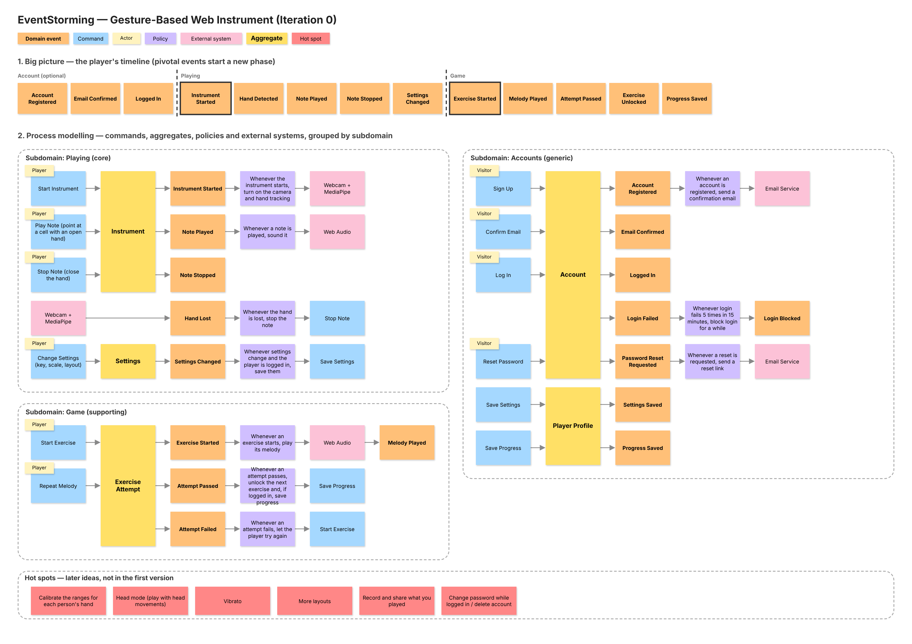
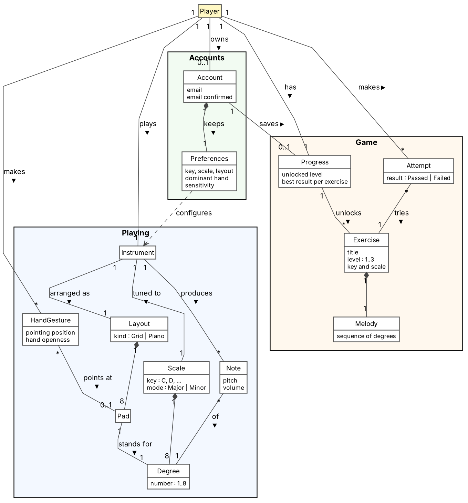
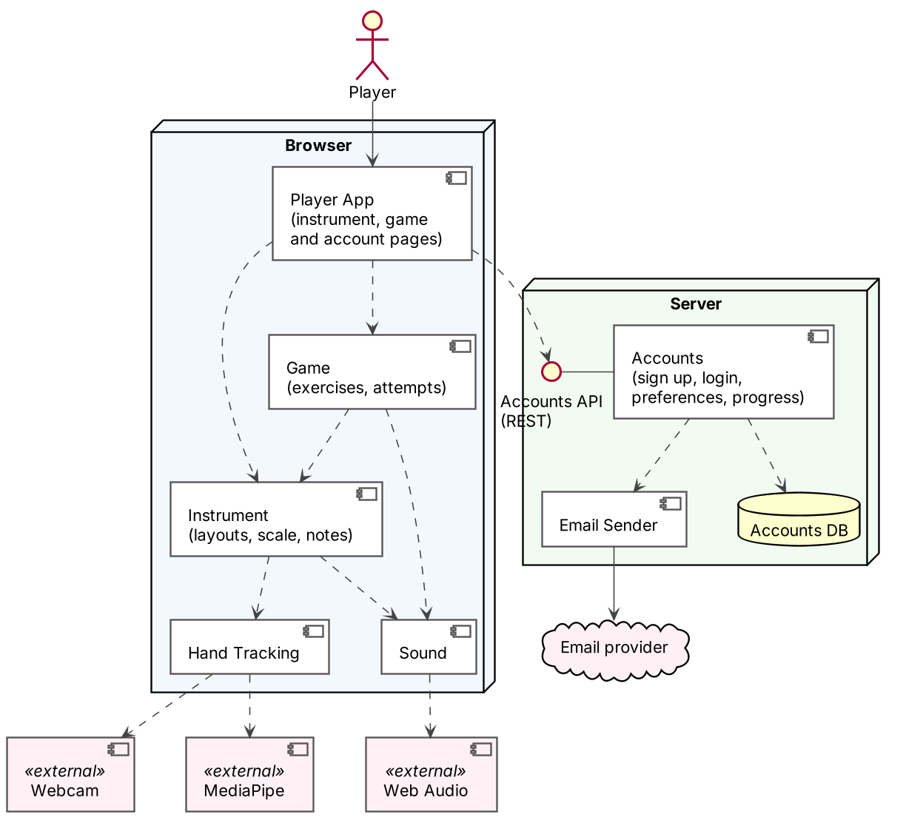

# Design

Design models of the **Gesture-Based Web Instrument**. They describe the whole product vision; the parts outside the MVP are marked as hot spots. The models are updated at the end of each iteration.

The sources are in [`design/`](design/): the EventStorming board opens in [diagrams.net](https://app.diagrams.net) (`eventstorming.drawio`), and the UML diagrams are [PlantUML](https://plantuml.com) files (`.puml`).

## History

| Iteration | Changes |
|---|---|
| 0 | First version of the three models, covering the whole product vision. |

## 1. EventStorming

**Big picture.** The player's timeline in three phases. The optional account comes first; the pivotal events *Instrument Started* and *Exercise Started* begin the playing and the game phases.

**Process modelling.** Each subdomain shows who issues each command (actor), the aggregate that handles it, the events it produces, the policies that react to them and the external systems involved.

| Subdomain | Type | Why |
|---|---|---|
| Playing | Core | Playing notes with hand gestures is what makes the product different. |
| Game | Supporting | An ear-training game that gives the player a reason to practise, built on top of playing. |
| Accounts | Generic | Sign up, login and password reset work like in any other app. |

The policies link the subdomains: when settings change or an attempt passes and the player is logged in, the settings or the progress are saved in the account.

## 2. Domain model

The model uses the language of the problem, not of the code:

- **Playing:** a player makes hand gestures. The gesture points at a pad of the instrument's layout (grid or piano), and the hand openness sets the volume. Each pad stands for a degree of the scale, so the instrument produces the note of that degree.
- **Game:** the "Listen and Repeat" ear-training game. An exercise has a melody (a sequence of degrees) played in its own key and scale. The player makes attempts to repeat it. Passing an attempt unlocks the next exercise in the player's progress.
- **Accounts:** an account is optional. It keeps the player's preferences and saves their progress.

## 3. Component diagram

- The **player** uses only the Player App in the browser.
- Everything that happens in real time (hand tracking, notes, sound, game) runs in the browser, so the app works without an account.
- **Instrument** and **Game** hold the rules and do not use the webcam, MediaPipe or Web Audio directly. **Hand Tracking** and **Sound** wrap those external systems.
- The **server** only has the **Accounts** component. It provides the Accounts API, owns its database and sends emails through the **Email Sender**.
