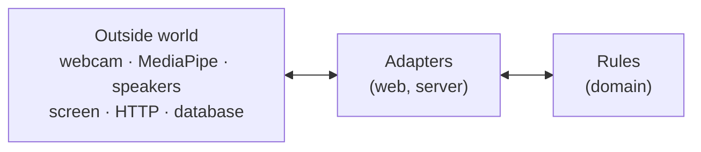
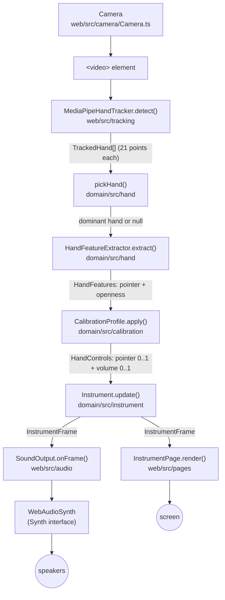
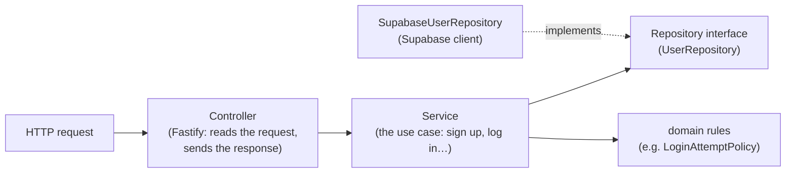

# Developer guide

How the code works, where new code goes and how to add a feature. Read the [README](../README.md) first to install and run the project, and [CONTRIBUTING](../CONTRIBUTING.md) for the git and PR workflow.

**Contents:** [1. The big idea](#1-the-big-idea) · [2. The real-time pipeline](#2-the-real-time-pipeline) · [3. Key concepts](#3-key-concepts) · [4. Where does my code go?](#4-where-does-my-code-go) · [5. Architecture rules](#5-architecture-rules) · [6. The server](#6-the-server) · [7. Testing](#7-testing) · [8. How to add a feature](#8-how-to-add-a-feature) · [9. Code style](#9-code-style) · [10. Common mistakes](#10-common-mistakes)

---

## 1. The big idea

The code is split into **rules** and **adapters**.

- **Rules** answer questions like "which note is under the finger?" or "should the note stop now?". They live in `packages/domain` and are plain TypeScript: no camera, no sound, no screen, no database.
- **Adapters** connect the rules to the outside world: the webcam, MediaPipe, the speakers, the HTML page, HTTP, the database. They live in `packages/web` and `packages/server`.



**Why split it like this?**

1. **Testing is easy.** A rule takes values and returns values, so a test needs no camera or speakers. Most of our tests run in milliseconds.
2. **Libraries can be swapped.** MediaPipe is hidden behind the `HandTracker` interface, and Web Audio behind `Synth`. Replacing one means writing one new class. Nothing else changes.
3. **You know where to look.** A wrong note is a rule problem (`domain`). No sound at all is probably an adapter problem (`web/src/audio`).

## 2. The real-time pipeline

This is what happens on **every camera frame** (about 30 times per second) while you play:



The class that runs these steps is [`InstrumentLoop`](../packages/web/src/instrument/InstrumentLoop.ts). Step by step:

1. **Camera** ([`Camera.ts`](../packages/web/src/camera/Camera.ts)) opens the webcam with `getUserMedia` and shows it in a `<video>` element. If it fails, it throws a `CameraError` with a reason (`denied`, `not-found`, …) so the page can show the right message.
2. **Hand tracking** ([`MediaPipeHandTracker.ts`](../packages/web/src/tracking/MediaPipeHandTracker.ts)) gives the current video frame to MediaPipe and gets back the hands it found. Each `TrackedHand` has 21 landmarks (points), whether it is the left or right hand, and the same points in metres (`worldLandmarks`).
3. **Pick the hand** ([`pickHand.ts`](../packages/domain/src/hand/pickHand.ts)) keeps only the player's dominant hand. The other hand is ignored.
4. **Features** ([`HandFeatureExtractor.ts`](../packages/domain/src/hand/HandFeatureExtractor.ts)) reduces the 21 points to the two values the instrument needs:
   - **pointer**: the index fingertip, **mirrored** (`x → 1 − x`), because the player sees the camera as a mirror;
   - **openness**: how far the fingertips are from the wrist, divided by the palm size (about 1 for a fist, 1.8 for an open hand). Dividing by the palm size means it doesn't change when the hand moves closer to the camera.
5. **Calibration** ([`CalibrationProfile.ts`](../packages/domain/src/calibration/CalibrationProfile.ts)) turns those raw values into `0..1`. For example, openness `1.0` (fist) → volume `0`, openness `1.8` (open) → volume `1`. Each range is a [`ControlCalibration`](../packages/domain/src/calibration/ControlCalibration.ts). The MVP uses `DEFAULT_CALIBRATION_PROFILE` for everyone.
6. **Instrument rules** ([`Instrument.ts`](../packages/domain/src/instrument/Instrument.ts)) asks the **layout** which degree is under the pointer (`layout.hitTest(pointer)`), then decides:
   - pointer on a cell **and** volume above the threshold (5%) → the note sounds;
   - moving to another cell while sounding → the new note starts (`{ kind: 'start', degree }`);
   - closing the hand, leaving the cells or losing the hand → the note stops (`{ kind: 'stop' }`);
   - otherwise nothing changes (`{ kind: 'none' }`).

   The result is an [`InstrumentFrame`](../packages/domain/src/instrument/InstrumentFrame.ts): hand found?, pointer, degree, volume, sounding?, and the change.
7. **Listeners** receive the frame. `InstrumentLoop` doesn't know who they are (the *Observer* pattern): `main.ts` subscribes them with `loop.subscribe(...)`.
   - [`SoundOutput`](../packages/web/src/audio/SoundOutput.ts) turns `start` into `synth.noteOn(scale.frequencyOf(degree))`, `stop` into `synth.noteOff()`, and sets the volume on every frame.
   - [`InstrumentPage`](../packages/web/src/pages/InstrumentPage.ts) moves the pointer, highlights the selected cell and updates the volume bar.

Adding a new listener (the game, a debug view) means one more `loop.subscribe(...)` in `main.ts`. The loop itself doesn't change.

**Where it all gets connected:** [`packages/web/src/main.ts`](../packages/web/src/main.ts) is the **composition root**. It's the only place that creates the concrete classes (`new MediaPipeHandTracker()`, `new WebAudioSynth()`, …) and passes them to each other through constructors. Every other class receives what it needs; it never creates it. That's why tests can pass a fake instead.

## 3. Key concepts

| Term | Meaning | In code |
|---|---|---|
| **Degree** | A position in the scale, from 1 to 8. 1 is the root, 8 is the root one octave higher. Not a fixed note: degree 1 is C in C major, G in G major. Exercises are written in degrees so they work in any key. | [`Degree`](../packages/domain/src/music/Degree.ts) (type `1 \| 2 \| … \| 8`) |
| **Pitch class** | A note name without octave: C, C#, D, … B. Sharps only. | [`PitchClass`](../packages/domain/src/music/PitchClass.ts) |
| **Scale type** | The pattern of distances (in semitones) from the root. Major: `0 2 4 5 7 9 11 12`. | [`ScaleType.MAJOR`, `ScaleType.NATURAL_MINOR`](../packages/domain/src/music/ScaleType.ts) |
| **Scale** | Root + scale type. Turns a degree into a MIDI note, a frequency and a label ("1 C"). | [`Scale`](../packages/domain/src/music/Scale.ts) |
| **MIDI note** | A number for each piano key. C4 (middle C) = 60, A4 = 69. Frequency = `440 × 2^((n − 69) / 12)` Hz. | `Scale.midiNoteOf`, `Scale.frequencyOf` |
| **Normalized coordinates** | Positions from 0 to 1 instead of pixels: x 0 = left, 1 = right; y 0 = top, 1 = bottom. The same numbers work on any screen size. | [`Point`](../packages/domain/src/geometry/Point.ts) |
| **Layout / Region** | How the 8 degrees are drawn on the play area (pad grid, piano). A region is one cell's rectangle. | [`Layout`](../packages/domain/src/layouts/Layout.ts), [`Region`](../packages/domain/src/layouts/Region.ts) |
| **Landmark** | One of the 21 points MediaPipe finds on a hand (wrist, joints, fingertips). | [`HandLandmark`](../packages/domain/src/hand/HandLandmark.ts) |
| **Calibration** | The range of hand movement that maps to 0..1. | [`CalibrationProfile`](../packages/domain/src/calibration/CalibrationProfile.ts) |
| **Frame** | The instrument's state after one camera frame. | [`InstrumentFrame`](../packages/domain/src/instrument/InstrumentFrame.ts) |

## 4. Where does my code go?

Ask these questions in order:

| Question | If yes | Example |
|---|---|---|
| Is it a **rule** that could be explained on paper, with no camera, sound, screen or network? | `packages/domain/src/<area>/` | Which pad is at a point; how many stars an attempt gets; when a login is blocked |
| Does it use a **browser API or a library** (camera, MediaPipe, Web Audio, `localStorage`)? | An **adapter** in `packages/web/src/`, behind an interface | `WebAudioSynth implements Synth` |
| Does it **draw** something or react to clicks? | A page in `packages/web/src/pages/` | `InstrumentPage` |
| Does it **call the server**? | A method on `ApiClient` in `packages/web/src/api/` | `isServerOnline()` |
| Is it an **HTTP route**? | A controller in its feature folder, `packages/server/src/features/<feature>/` | `features/health/HealthController` |
| Is it server logic or database access? | A service / repository in the same feature folder (see [6](#6-the-server)) | `AccountService`, `SupabaseUserRepository` (future) |
| Is it server code **shared by several features**? | `packages/server/src/shared/` (or `config/` for settings read at start-up) | `createSupabaseClient`, `readConfig` |
| Does it **create objects and connect them**? | Only in `main.ts` (web) or `buildApp` (server) | — |

Folders are grouped by **topic** (`music`, `hand`, `audio`, …), not by kind of file. Tests sit **next to** the code they test (`Scale.ts` + `Scale.test.ts`). Anything the other packages need from `domain` must be **exported from [`packages/domain/src/index.ts`](../packages/domain/src/index.ts)**.

## 5. Architecture rules

These rules come from [CLAUDE.md](../CLAUDE.md). Most of them are **checked automatically**: if you break one, `npm run lint` or `npm run typecheck` fails with a message telling you what to do.

| # | Rule | How it's enforced | What you'll see if you break it |
|---|---|---|---|
| 1 | `domain` never imports outside libraries and never uses browser APIs | ESLint `no-restricted-imports` / `no-restricted-globals` on `packages/domain` ([eslint.config.js](../eslint.config.js)); the domain [tsconfig](../packages/domain/tsconfig.json) has no `DOM` lib, so `document` etc. don't even exist there | *"The domain must not use browser APIs. Put this in an adapter in the web package."* or a TypeScript error `Cannot find name 'document'` |
| 2 | Only `MediaPipeHandTracker` imports MediaPipe | ESLint on `packages/web/src` | *"Only MediaPipeHandTracker may import MediaPipe. Use the HandTracker interface."* |
| 3 | Only `WebAudioSynth` uses Web Audio | ESLint bans `AudioContext` elsewhere in web | *"Only WebAudioSynth may use the Web Audio API. Use the Synth interface."* |
| 4 | `web` and `server` depend on `domain`; `domain` depends on nothing | ESLint bans imports of web/server from domain | *"The domain must not depend on the web or server packages."* |
| 5 | Server: controller → service → repository; services use repository interfaces | ESLint bans Fastify outside `*Controller.ts` and `app.ts`, and Supabase outside `Supabase*.ts` and `shared/supabase/` | *"Only controllers (and app.ts) may use Fastify…"* |
| 6 | The browser talks to the server only through `ApiClient` | **Convention** (not checked by lint): code review | — |
| 7 | Use a design pattern only where there is a real reason | Code review | — |

## 6. The server

The server only exists for the optional accounts. Today it has one route, `GET /api/health`, used by the page to show "Server: online".

- [`app.ts`](../packages/server/src/app.ts): `buildApp()` creates the Fastify app and registers every controller, **without** starting it. Tests use it directly with `app.inject(...)` (no network, no port).
- [`main.ts`](../packages/server/src/main.ts): the composition root. Reads the configuration ([`config/env.ts`](../packages/server/src/config/env.ts)), creates the Supabase client ([`shared/supabase/createSupabaseClient.ts`](../packages/server/src/shared/supabase/createSupabaseClient.ts)) and the objects each feature needs, calls `buildApp()` and starts listening on port 3000.
- [`features/health/`](../packages/server/src/features/health/): the health feature. `HealthController` (one class per group of routes, with a `register(app)` method) asks a `DatabaseStatus` interface whether the database answers; `SupabaseDatabaseStatus` implements it.

**Folders: one per feature.** The server will grow (accounts, saved settings, progress), so code is grouped **by feature first, then by layer** inside the feature:

```text
packages/server/src/
├── main.ts, app.ts       # wiring
├── config/               # settings read at start-up (.env)
├── shared/               # code used by several features (the Supabase client)
└── features/
    ├── health/           # HealthController, DatabaseStatus, SupabaseDatabaseStatus (+ tests)
    └── accounts/         # (future) AccountController, AccountService, UserRepository, SupabaseUserRepository
```

- Everything about one feature sits in one folder, so a change to "accounts" touches one folder and teammates working on different features rarely conflict.
- File names keep the role suffix (`*Controller`, `*Service`, `*Repository`, `Supabase*`) so the layer is clear without layer folders. The lint rules use these names.
- **Features don't import each other's files.** If two features need the same thing, move it to `shared/`.
- Tests sit next to the file they test. `app.test.ts` only has app-wide tests (unknown route → 404).

**In development**, the browser opens `http://localhost:5173` (Vite). Vite forwards every request starting with `/api` to the server on port 3000 ([`vite.config.ts`](../packages/web/vite.config.ts)). So the browser sees one address: no CORS problems, and cookies just work.

**Layers for new server features** (from the accounts stories on):



- The **controller** only translates HTTP ↔ service calls. No rules here.
- The **service** does the work. It knows nothing about HTTP (no Fastify import, enforced) and talks to the database only through a **repository interface**.
- The **repository** is the only place that talks to the database, through the Supabase client (`@supabase/supabase-js`, enforced by lint). No ORM.
- Everything is connected with **constructors** in `main.ts` / `buildApp`: `new AccountController(new AccountService(new SupabaseUserRepository(supabase)))`. Tests pass an in-memory fake repository instead.

## 7. Testing

We use [Vitest](https://vitest.dev/). A test file ends in `.test.ts` and sits next to the code it tests.

```ts
import { describe, expect, it } from 'vitest';
import { Scale } from './Scale';
import { ScaleType } from './ScaleType';

describe('Scale', () => {                      // a group of tests about one thing
  it('gives 440 Hz for degree 1 in A', () => { // one behaviour, said in plain words
    const scale = new Scale('A', ScaleType.MAJOR);   // 1. arrange
    const frequency = scale.frequencyOf(1);          // 2. act
    expect(frequency).toBeCloseTo(440);              // 3. assert
  });
});
```

**Good tests:** one behaviour per `it`, a name that reads like a sentence, and values taken from the acceptance criteria (if the story says "A4 = 440 Hz", test exactly that).

**Fakes instead of real devices.** We don't need a camera, speakers or a server in tests, because the code depends on interfaces:

| Real thing | Fake used in tests | Example test |
|---|---|---|
| MediaPipe | [`FakeHandTracker`](../packages/web/src/tracking/FakeHandTracker.ts): returns the hands you give it with `setHands()` | [`InstrumentLoop.test.ts`](../packages/web/src/instrument/InstrumentLoop.test.ts) |
| A real hand | `makeHand({ indexTip, reach, handedness })` from `@instrument/domain/testing` | [`HandFeatureExtractor.test.ts`](../packages/domain/src/hand/HandFeatureExtractor.test.ts) |
| Web Audio | A small class that implements `Synth` and records the calls | [`SoundOutput.test.ts`](../packages/web/src/audio/SoundOutput.test.ts) |
| A layout | An object with `regions` and `hitTest` (left half = 1, right half = 2) | [`Instrument.test.ts`](../packages/domain/src/instrument/Instrument.test.ts) |
| `fetch` / the server | A function that returns a fixed `Response` | [`ApiClient.test.ts`](../packages/web/src/api/ApiClient.test.ts) |
| The network | `app.inject({ method: 'GET', url: '/api/health' })` | [`HealthController.test.ts`](../packages/server/src/features/health/HealthController.test.ts) |

**What must have tests** (from the [Definition of done](iterations/0/definition-of-done.md)): unit tests for every rule in `domain` (required); integration tests for every server route; a manual test (see the README checklist) for anything that depends on the camera or on sound.

Run while you work: `npm run test:watch`. Run one file: `npx vitest run packages/domain/src/music/Scale.test.ts`.

## 8. How to add a feature

### Worked example: the 2×4 pad grid (US-E4-01, issue #26)

Today the page uses `SingleBoxLayout` (one box, degree 1). The next step is the pad grid. This is the usual order of work:

**1. Read the story.** In [#26](https://github.com/MESW-LES-2627/les-project-group-5/issues/26): in landscape, 2 rows × 4 columns, degrees 1–4 at the bottom, 5–8 on top, a point in a gap selects the nearest pad, and border hysteresis.

**2. Write the tests first, from the acceptance criteria.** Create `packages/domain/src/layouts/PadGridLayout.test.ts`:

```ts
import { describe, expect, it } from 'vitest';
import { PadGridLayout } from './PadGridLayout';

describe('PadGridLayout (landscape)', () => {
  const layout = new PadGridLayout();

  it('puts degree 1 at the bottom left', () => {
    expect(layout.hitTest({ x: 0.1, y: 0.9 })).toBe(1);
  });

  it('puts degree 8 at the top right', () => {
    expect(layout.hitTest({ x: 0.9, y: 0.1 })).toBe(8);
  });
});
```

Run `npm run test:watch`. The tests fail (the class doesn't exist yet). That's expected.

**3. Write the rule.** Create `packages/domain/src/layouts/PadGridLayout.ts` and implement the `Layout` interface (`regions(scale)` and `hitTest(point)`). Look at [`SingleBoxLayout.ts`](../packages/domain/src/layouts/SingleBoxLayout.ts) for the shape. Keep going until the tests pass, then add tests for the remaining criteria (gaps, edges, hysteresis).

**4. Export it** from [`packages/domain/src/index.ts`](../packages/domain/src/index.ts):

```ts
export { PadGridLayout } from './layouts/PadGridLayout';
```

**5. Use it in the app.** In [`packages/web/src/main.ts`](../packages/web/src/main.ts), replace `new SingleBoxLayout()` with `new PadGridLayout()`. Nothing else changes: the loop, the sound and the page all work through the `Layout` interface.

**6. Check and ship.** `npm run check`, run the app and do the manual test, then open a PR with `Closes #26` (see [CONTRIBUTING](../CONTRIBUTING.md#4-pull-requests)).

### Recipe: a new server feature

1. Write the **domain rule** and its tests, if there is one (for example `LoginAttemptPolicy` for US-E2-01).
2. Create the feature folder `packages/server/src/features/<feature>/`. Steps 3–6 put their files there.
3. Define a **repository interface** with only the methods the service needs (`findByEmail`, `save`).
4. Write the **service** using the interface, and test it with an in-memory fake repository.
5. Write the **Supabase repository** (`Supabase<Name>Repository`) that implements the interface with the shared Supabase client.
6. Write the **controller**: read the request, call the service, send the response. Test it with `app.inject`.
7. **Wire** it in `main.ts` / `buildApp` through constructors.
8. Add a method to **`ApiClient`** for the browser to call it, and test it with a fake `fetch`.

### Recipe: wrapping a new browser API or library

1. Define an **interface** in `web` with only what the app needs (like [`Synth`](../packages/web/src/audio/Synth.ts)).
2. Write the **real adapter** that implements it, the only file that touches the API (like `WebAudioSynth`).
3. Write a **fake** for tests (like `FakeHandTracker`).
4. Create the real adapter in `main.ts`, and add an ESLint rule so no other file uses the API directly (ask the team first).

## 9. Code style

- **Small classes, one job each.** If you need "and" to describe a class, split it.
- **Clear names over short names:** `selectedDegree`, not `sd`. Classes are nouns (`SoundOutput`), methods are verbs (`noteOn`).
- **Comments explain *why*, not *what*.** The code shows what it does. A comment says why: *"The pointer is mirrored because the player sees the camera as a mirror."*
- **No magic numbers.** Give them a name and a comment: `const DEFAULT_VOLUME_THRESHOLD = 0.05;`.
- **`readonly` by default.** Change state only where it has to change.
- **Validate in the constructor.** A value object can't be created invalid (see [`ControlCalibration`](../packages/domain/src/calibration/ControlCalibration.ts), which throws a `RangeError` if `min >= max`).
- **Depend on interfaces, receive them through the constructor.** Don't call `new` for a dependency inside a class. Take it as a parameter.
- **Patterns only with a reason.** The Observer in `InstrumentLoop` exists because several unrelated listeners need the frames. Don't add a pattern "just in case".

## 10. Common mistakes

| Mistake | Fix |
|---|---|
| Using `document`, `window`, `fetch` or `AudioContext` in `domain` | Move that code to an adapter in `web`, and give the domain rule plain values. |
| Calling `fetch` from a page | Add a method to `ApiClient` and call that. |
| `import … from '@instrument/domain'` fails for your new class | Export it in `packages/domain/src/index.ts`. |
| No sound in the browser | Audio can only start inside a click. `synth.start()` must be the first `await` in the Start button's handler (see `main.ts`). |
| Camera doesn't open on another device | Browsers only allow the camera on `localhost` or `https://`. |
| Creating classes inside other classes (`new WebAudioSynth()` inside `SoundOutput`) | Take it as a constructor parameter and create it in `main.ts`. Then tests can pass a fake. |
| A PR that mixes several issues | One issue per branch and PR. |
